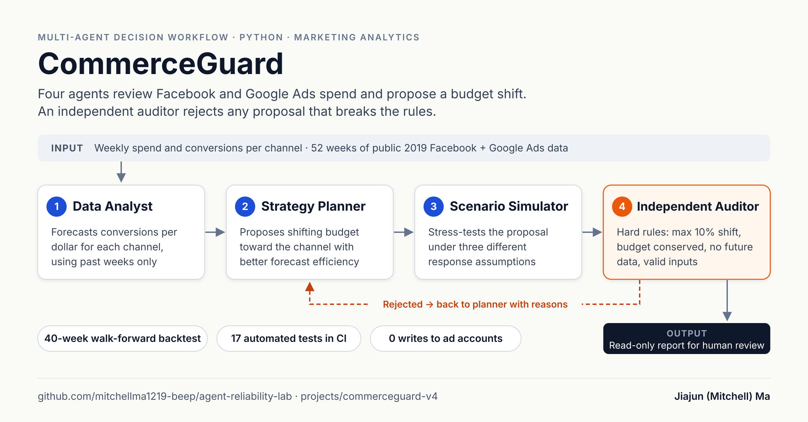
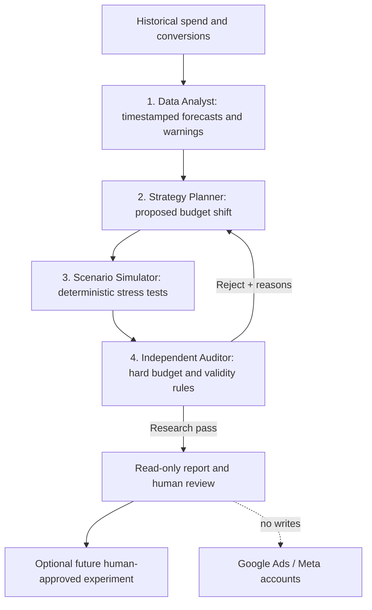

# CommerceGuard: Multi-Agent Decision Workflow for Digital Ad Budgets



> **Status: research prototype, read-only by design.** It does not connect to any ad account, spend money, or claim measured causal lift. The four agents in the runnable core are deterministic Python roles. An optional Google ADK / Gemini version, in which LLM agents work behind the same hard audit gate, is included but has not been tested end to end against a live API.

## In 30 seconds

Marketing teams move budget between channels such as Facebook and Google Ads every week, often based on the conversion rates each platform reports. Those numbers are useful but easy to over-trust: platforms can count the same customer twice, and a high average conversion rate does not mean the next dollar will perform the same way.

CommerceGuard splits the weekly budget review into four roles that check each other:

1. A **Data Analyst** forecasts each channel's conversions per dollar using only data available at decision time.
2. A **Strategy Planner** proposes moving part of the budget toward the channel that forecasts better.
3. A **Scenario Simulator** stress-tests that proposal under three different assumptions about how conversions respond to spend.
4. An **Independent Auditor** applies hard rules (no more than a 10% shift per week, total budget conserved, no future data, valid inputs) and sends rejected proposals back to the planner with reasons.

Whatever passes becomes a read-only recommendation for a person to review. Nothing is executed automatically.

## Business problem

| Question a marketing team asks | What CommerceGuard does about it |
|---|---|
| Which channel should get more budget next week? | Forecasts conversion efficiency per channel and proposes a specific, traceable shift. |
| How do we stop an over-confident recommendation? | A separate auditor role enforces limits in code instead of trusting the planner to police itself. |
| How sensitive is the recommendation to our assumptions? | The simulator reports results under three named response assumptions rather than one number. |
| Can we trust the forecast? | Every forecast is scored in a walk-forward backtest against a simple baseline. |

## Example run

The final week of the dataset, run through the orchestrator (`Orchestrator().decide(history, target_week=52)`):

```text
Data Analyst   forecast conversions per $:  facebook 0.1376 · google 0.0449
Round 1  Planner: shift 20% to facebook  →  Auditor: REJECT (over_limit)
Round 2  Planner: shift 15% to facebook  →  Auditor: REJECT (over_limit)
Round 3  Planner: shift 10% to facebook  →  Auditor: PASS
Decision: research_only · production_write_allowed: False
```

The simulator's figures for the accepted 10% shift range from about 7 to 24 extra conversions over the last four weeks, depending on the assumed response. Those are **assumption-based scenarios, not measured outcomes**.

## Architecture



| Agent | Input | Output | Failure it is there to catch |
|---|---|---|---|
| Data Analyst | Historical, timestamped weekly data | Conversions-per-dollar forecast + attribution warning | Look-ahead bias, too little history |
| Strategy Planner | Forecasts + auditor feedback | Explicit allocation proposal with a reason | Untraceable recommendations |
| Scenario Simulator | Proposal + recent history | Results under three named elasticity scenarios | Hidden economic assumptions |
| Independent Auditor | All of the above | Pass / reject with reasons | Over-limit shifts, broken budgets, invalid or leaked inputs |

An `Orchestrator` runs the loop for up to five rounds. The planner steps its proposal down (20% → 15% → 10% → 5% → 0%) after each rejection. Splitting the work into separate roles means no single component grades its own output.

**Two implementations:**

- `src/research.py`: the runnable core. All four roles are deterministic Python classes, standard library only. This is what the tests and the backtest exercise.
- `src/adk_live_v3_reference.py`: an optional version built on Google's Agent Development Kit, in which Gemini agents (Data Analyst, Strategy Planner, Simulation Critic, Independent Auditor) review and critique each proposal, while the deterministic auditor remains the hard gate. It requires a `GOOGLE_API_KEY` and **has not been run against a live Gemini account**.

## Technology stack

| Area | Used |
|---|---|
| Language | Python 3.10+ (core uses the standard library only) |
| Agent design | Four-role orchestration with a reject-and-revise feedback loop |
| Optional LLM layer | Google ADK (`google-adk`), Gemini 2.5 Flash, structured JSON outputs |
| Evaluation | Walk-forward (prequential) backtesting, nested past-only model selection, MAE |
| Testing / CI | `unittest` (17 tests), GitHub Actions, `ruff` |
| Data | Public 2019 Facebook / Google Ads campaign data; optional adapter for Google Meridian's simulated MMM dataset |

## Key features

- **Time-safe forecasting.** The analyst refuses to run if any data from the target week or later is present.
- **Hard guardrails in code, not in prompts.** Transfer limit, budget conservation, non-finite values, unknown channels and negative budgets are all checked by the auditor.
- **Reject-and-revise loop.** Rejections go back to the planner with machine-readable reasons.
- **Honest benchmarking.** Every forecasting method is compared with simple baselines, and losing results are reported.
- **Audit trail.** Each run writes per-week forecasts, decisions, rounds and a SHA-256 checksum of the input data.
- **Zero-write design.** `production_write_allowed` is hard-coded to `False`, and there are no Google Ads or Meta API calls.

## Installation and usage

```bash
git clone https://github.com/mitchellma1219-beep/agent-reliability-lab.git
cd agent-reliability-lab/projects/commerceguard-v4

python3 src/research.py                    # run the 40-week backtest
python3 -m unittest discover -s tests -v   # run the 17 tests
```

No packages, credentials or network access are needed for the above. Outputs go to `outputs/`:

- `backtest_v4.json`: summary metrics and the data checksum
- `forecasts_v4.csv`: every weekly forecast, actual value and absolute error
- `policies_v4.csv`: every weekly decision, number of audit rounds and accepted shift

Optional extras:

```bash
python3 src/meridian_adapter.py --fetch    # download and schema-check Google's simulated MMM data (needs network)

pip install -r requirements-llm.txt        # Google ADK, for the experimental LLM version
export GOOGLE_API_KEY=...                  # never commit this
python3 src/adk_live_v3_reference.py
```

## Testing and validation

**Automated tests (17, all passing in CI):** look-ahead protection, minimum history, invalid lookback windows, NaN / infinite / boolean inputs, unknown channels, negative budgets, budget conservation, over-limit rejection, missing simulations, the three-round reject-and-revise loop, the 40-week holdout structure and the Meridian schema checks.

**Backtest.** The 52 weeks are kept in date order. The first 12 are used for training; for each of the remaining 40 weeks, models are trained on earlier weeks only and the forecast is fixed before the actual week is revealed.

| Mean absolute error, conversions per dollar (lower is better) | Facebook | Google |
|---|---:|---:|
| Last week's rate (naive baseline) | 0.016350 | 0.004966 |
| Trailing 12-week average | **0.012891** | **0.003363** |
| Nested regularized model (window chosen on past data only) | 0.013336 | 0.003377 |

- The trailing 12-week average cut forecast error by about 21% (Facebook) and 32% (Google) compared with the naive baseline.
- The more complex nested model **did not** beat the simpler 12-week average on this dataset. That result is reported rather than hidden.
- All 40 weekly decisions passed the auditor after three rounds; the first two, more aggressive proposals were rejected each time.

These are **forecast-accuracy** results. They are not evidence of profit or incremental lift. See [docs/METHODOLOGY.md](docs/METHODOLOGY.md) for what the data can and cannot answer.

## Datasets and provenance

**Dataset A (included, observational, third-party, provenance not independently verified):** [2019 Facebook / Google AdWords campaign data](https://github.com/heckur08/A-B-Testing-for-Marketing-Campaigns/blob/main/marketing_campaign.csv), daily spend and conversions aggregated to 52 complete weeks in `data/public_weekly_2019.csv`. It cannot identify the incremental effect of budget changes or remove conversions counted by both networks. Attribution for the original data remains with the upstream publisher.

**Dataset B (official Google sample, simulated, optional download):** [Google Meridian national_all_channels.csv](https://github.com/google/meridian/blob/main/meridian/data/simulated_data/csv/national_all_channels.csv), 156 weeks, five paid channels, with promotion and competitor controls. `src/meridian_adapter.py` downloads it and validates its schema. **It has not been modelled or benchmarked in this project**, and it is not combined with Dataset A.

## Limitations and safety

- Conversion rates reported by platforms are observational and may overlap across networks; they are not marginal causal returns.
- The simulator's results depend entirely on the assumed elasticities.
- No credentials, write scopes, account IDs or OAuth secrets are used, and none are needed.
- Any future read-only API integration should use least-privilege access, redact personal data, log every decision, cap daily and per-channel changes, and require human sign-off.

## Future improvements

- [x] Offline research pipeline, tests and CI
- [x] Time-safe forecasting, nested model comparison, budget guardrails and audit trail
- [x] Adapter for a second, officially documented simulated dataset
- [ ] Test the Google ADK / Gemini multi-agent version end to end with structured outputs
- [ ] Build an adstock- and saturation-aware media-mix model on the Meridian data
- [ ] Calibrate recommendations with randomized lift or geo experiments
- [ ] Use first-party purchase data to deduplicate conversions and measure profit net of returns
- [ ] Read-only dashboard with a human review queue
- [ ] Human-approved pilot with rollback; no automatic spending without evidence

## References

- Google Ads budgets: https://developers.google.com/google-ads/api/docs/campaigns/budgets/overview
- Google Meridian: https://developers.google.com/meridian/notebook/meridian-getting-started
- Google ADK: https://google.github.io/adk-docs/

## License

The original source code in this project is released under the MIT License (see `LICENSE`). This does not relicense upstream datasets or Google software; follow their licenses and attribution.

---

Built by [Jiajun (Mitchell) Ma](https://www.linkedin.com/in/jiajun-mitchell-ma), MS Business Analytics, USC Marshall. Part of the [agent-reliability-lab](../../README.md) repository.
