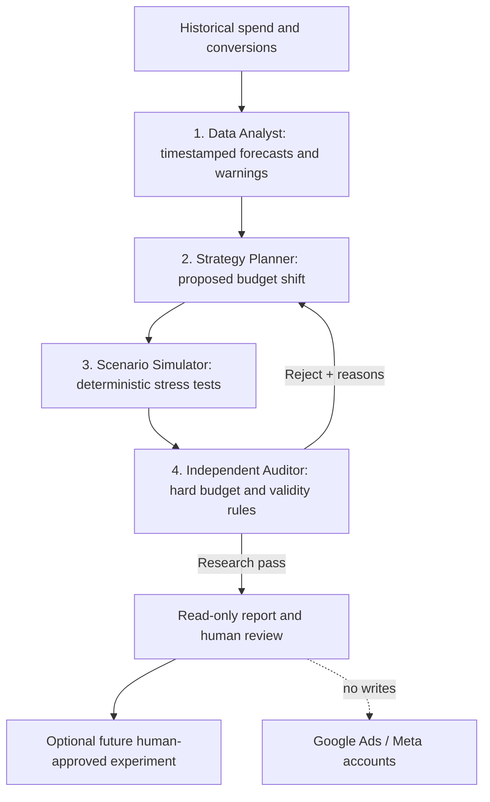

# CommerceGuard V4 — Auditable Multi-Agent Marketing Budget Research

> **Status: research-only prototype.** No advertising account access. No claim of measured causal lift. No autonomous spending. The core workflow uses four deterministic role implementations; the optional Google ADK / Gemini interface is experimental and has not been end-to-end authenticated in this environment.

CommerceGuard studies the problem of **allocating marketing budget across channels** without confusing platform-reported conversion rates with incremental business return. Google's Smart Bidding already handles real-time auction bidding within campaigns. This project deliberately operates one decision layer above it: decision support, reproducible evaluation, simulation and risk management.

## Who is it for?

- Marketing analytics teams assessing weekly Google Ads / Meta budget allocations.
- E-commerce operators seeking a read-only budget-review assistant before enabling any changes.
- Data scientists studying observational bias, walk-forward validation and guardrails.
- AI agent engineers looking for a generator → challenger → auditor feedback loop.
- Students building a serious, safety-aware portfolio project.

**Not appropriate for:** autonomous ad spend, financial promises, real-time competitor bid scraping, causal claims from observational data, or use with unverified conversion attribution.

## Architecture



The workflow is **scientifically defensible in its boundaries**, not causal-proof: (1) strict chronological train/test separation, (2) nested historical-only selection for forecasting experiments, (3) measured prediction accuracy separated from *assumption-based* counterfactual spend simulations, (4) independent deterministic guardrails rather than self-certification, (5) explicit zero-write design and human approval, (6) adversarial tests for data leakage and invalid proposals.

**Important result:** the more sophisticated V4 nested regularized model did **not** beat the simpler 12-week pooled-rate baseline on the 2019 sample. We report that failure instead of cherry-picking a favorable score.

## Datasets and provenance

**Dataset A (included, observational public third-party, provenance not independently verified):** [2019 Facebook / Google AdWords campaign data](https://github.com/heckur08/A-B-Testing-for-Marketing-Campaigns/blob/main/marketing_campaign.csv), daily spend and conversions, aggregated to 52 complete weeks. This dataset cannot identify incremental effects of budget changes or deduplicate conversions across networks. `data/public_weekly_2019.csv` is the derived aggregation used for reproducible runs. Original data attribution remains with the upstream publisher.

**Dataset B (official Google sample, simulated, optional download):** [Google Meridian national_all_channels.csv](https://github.com/google/meridian/blob/main/meridian/data/simulated_data/csv/national_all_channels.csv). This dataset has 156 weeks, five paid channels, conversions, revenue per conversion, promotion and competitor controls. The `src/meridian_adapter.py` validates and downloads it in an internet-connected environment. **This second dataset has not been executed or statistically benchmarked here**: it is not a substitute for live commercial data or experimental identification. We do not combine it with the original 2019 dataset or imply shared attribution.

## Quickstart (Python 3.10+; standard library only)

```bash
python3 src/research.py
python3 -m unittest discover -s tests -v
```

Outputs:

- `outputs/backtest_v4.json`: summary, accuracy benchmarks, data source checksum.
- `outputs/forecasts_v4.csv`: each weekly point prediction, baseline and absolute error.
- `outputs/policies_v4.csv`: each simulated policy, decision time, audit iterations.

To inspect Google's official simulated MMM dataset (requires network):

```bash
python3 src/meridian_adapter.py --fetch
```

This fetch validates the **schema**, not allocation impact. To use that dataset for full optimization, first implement an MMM model with temporal controls, carryover, response saturation, proper holdouts and preferably incrementality calibration; never transplant the two-channel CPD heuristic.

## Evaluation methodology

1. Sort 52 complete historical weeks chronologically; use first 12 as initial training.
2. For each of the following 40 weeks, train on previous weeks **only**. Record next-week prediction error after the forecast is fixed.
3. Benchmark last week's conversion efficiency, a fixed trailing 12-week pooled estimate, and an experimental regularized method whose lookback is chosen by **inner, past-only** one-step-ahead errors.
4. Planner proposes a spend transfer; independent simulator runs explicit elasticity sensitivity cases on training history, **not** held-out actual incremental outcomes.
5. Auditor rejects invalid channels, nonfinite inputs, over-limit transfers (>10%), negative budgets, missing simulations and time leakage. Accepted outputs remain `research_only`.

### Reproduced results (40 holdout weeks)

| MAE: conversions per spend-dollar, lower better | Facebook | Google |
|---|---:|---:|
| Last week | 0.016350 | 0.004966 |
| Fixed 12-week average | **0.012891** | **0.003363** |
| Nested regularized selection | 0.013336 | 0.003377 |

Note: this is **forecast error**, not marketing profit or incremental lift. The nested model loses to fixed 12-week here. In real use, add time-series uncertainty quantification, first-party orders and randomized incremental experiments before recommending changes.

## Why four agents?

| Role | Input | Output | Primary failure mode caught |
|---|---|---|---|
| Data Analyst | Historical, timestamped data | CPD forecasts + attribution warning | Look-ahead, insufficient data |
| Strategy Planner | Forecasts + prior feedback | Explicit allocation proposal | Untraceable recommendations |
| Scenario Simulator | Proposal + historical sample | Named sensitivity scenarios | Hidden economic assumptions |
| Independent Auditor | All artifacts | Pass/reject + reasons | Invalid budgets, unsafe execution |

Four independent *responsibilities* reduce single-model self-grading. In the runnable core, these are deterministic software roles, **not four independent live LLM sessions**. An earlier V3 optional ADK experimental interface is included separately under `src/adk_live_v3_reference.py`, not claimed as tested against Google APIs.

## Deployment and safety

No credentials, write scopes, account IDs, OAuth secrets or production deployment are required. There are no calls to Google Ads/Meta APIs. `production_write_allowed` is hardcoded false in the decision result. Future read-only API integration should explicitly request least-privilege access, redact PII, log decisions, impose daily and per-channel budget limits, and require human sign-off. Do not run backtests as though simulated scenarios proved real outcomes.

## Roadmap

- [x] Publish clean offline research pipeline and tests.
- [x] Strict chronological predictions; nested comparison; budget guardrails; audit trail.
- [x] Add adapter for a second officially documented simulated dataset.
- [ ] Validate national and geo Meridian feeds, build saturation/adstock-aware MMM.
- [ ] Calibrate allocations with independent randomized lift or geo experiments.
- [ ] First-party purchase attribution and profitability (net of returns).
- [ ] Properly tested, structured-output Google ADK multi-agent runtime.
- [ ] Interactive read-only dashboard, model monitoring and review queue.
- [ ] Human-approved controlled pilot with rollback; no direct auto-spend without evidence.

## Source and related documentation

- Google Ads budget behavior: https://developers.google.com/google-ads/api/docs/campaigns/budgets/overview
- Google Meridian sample and methodology: https://developers.google.com/meridian/notebook/meridian-getting-started
- Google Meridian national sample: https://github.com/google/meridian/blob/main/meridian/data/simulated_data/csv/national_all_channels.csv
- 2019 third-party advertising observations: https://github.com/heckur08/A-B-Testing-for-Marketing-Campaigns/blob/main/marketing_campaign.csv
- Google ADK: https://google.github.io/adk-docs/

## License

The **original project source code** in this repository is distributed under the MIT License (see `LICENSE`). This does not relicense upstream datasets or Google software; follow upstream licensing and attribution for third-party assets.